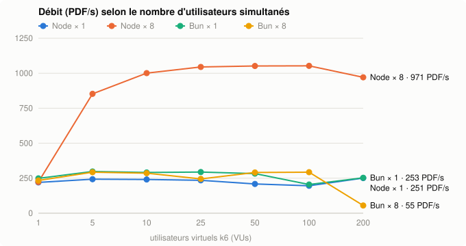
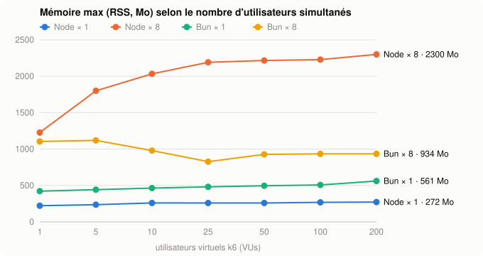

# pdfjs

Génère des PDF depuis du HTML/CSS en Node.js, **sans navigateur** (ni Chrome ni Puppeteer).

La mise en page est faite par [Yoga](https://yogalayout.dev) via [`@react-pdf/renderer`](https://react-pdf.org) : flexbox complet, pagination automatique, texte sélectionnable. Le HTML et les balises `<style>` sont lus par [`react-pdf-html`](https://github.com/danomatic/react-pdf-html).

## Installation

```bash
npm install
```

Node.js 22.18 ou plus récent (exécute le TypeScript directement, sans build), ou Bun.

## Ligne de commande

```bash
node pdfjs.ts facture.html facture.pdf
```

| Option | Exemple | |
|---|---|---|
| `--size` | `--size A5` | format de page (`A4` par défaut, `A3`, `LETTER`…) |
| `--landscape` | | orientation paysage |
| `--margin` | `--margin 30` | marges en pt (40 par défaut) |
| `--font` | `--font Georgia` | police par défaut |
| `--font-size` | `--font-size 11` | taille par défaut (12) |
| `--font-file` | `--font-file Georgia=./Georgia.ttf` | enregistre une police, répétable |
| `--header` | `--header '<p>Rapport</p>'` | en-tête répété sur chaque page |
| `--footer` | `--footer '<p>{page} / {pages}</p>'` | pied de page répété sur chaque page |
| `--title` | `--title 'Facture 42'` | titre dans les métadonnées du PDF |
| `--remote-images` | | autorise les images `http(s)` |

Les images locales sont autorisées depuis le dossier du fichier HTML (et ses sous-dossiers).

## API

```ts
import { htmlToPdf } from './pdfjs.ts';

// Écrit un fichier
await htmlToPdf('<h1>Bonjour</h1>', { output: 'bonjour.pdf' });

// Sans `output` : renvoie un Buffer (pour une réponse HTTP, un e-mail, un stockage…)
const pdf = await htmlToPdf(html);
```

Toutes les options :

```ts
await htmlToPdf(html, {
  output: 'rapport.pdf',          // sinon : Buffer
  size: 'A4',                     // 'A3', 'LETTER'… ou [largeur, hauteur] en pt
  landscape: false,
  margin: 40,                     // ou { top: 60, right: 40, bottom: 50, left: 40 } (pt)
  font: 'Helvetica',              // Helvetica, Times-Roman, Courier, ou une police de `fonts`
  fontSize: 12,
  fonts: {
    Georgia: [
      { src: './fonts/Georgia.ttf' },
      { src: './fonts/Georgia-Bold.ttf', fontWeight: 'bold' },
      { src: './fonts/Georgia-Italic.ttf', fontStyle: 'italic' },
    ],
    Verdana: './fonts/Verdana.ttf', // un seul fichier suffit
  },
  header: '<p style="color: gray">Rapport — confidentiel</p>',
  footer: '<p style="text-align: right">Page {page} / {pages}</p>',
  meta: { title: 'Rapport', author: 'Moi', subject: '', keywords: '' },
  images: { baseDir: './templates', remote: false },
});
```

### Polices

- Formats : `.ttf`, `.otf`, `.woff` (pas `.woff2`), chemin local ou URL.
- Une police enregistrée est aussi utilisable en CSS : `font-family: Georgia`.
- Sans fichier gras ou italique, le texte en `<b>` / `<i>` s'affiche avec le fichier normal (pas de faux gras ni de faux italique).
- `registerFonts(fonts)` est exporté pour enregistrer les polices une fois au démarrage.

### Images

Le HTML peut venir d'une source non fiable, donc **par défaut seules les images `data:` sont chargées**.

| Source | Autorisée si… |
|---|---|
| `data:image/...` | toujours |
| `logo.png`, `img/a.jpg` | `images.baseDir` est défini, et le fichier est **dans** ce dossier (`../`, chemins absolus et liens symboliques qui en sortent sont refusés) |
| `https://...` | `images.remote: true` (attention : la génération ira chercher n'importe quelle URL écrite dans le HTML) |
| `file://`, autres | jamais |

Une image refusée ou introuvable n'est pas affichée et un avertissement est écrit dans la console.

Comme dans un navigateur, une image sans taille garde sa taille naturelle (1 px = 1 pt), sans dépasser la largeur disponible. `width` / `height` (attributs ou CSS) sont respectés, avec conservation des proportions si un seul est donné.

Formats : PNG et JPEG. Les SVG doivent être écrits directement dans le HTML (`<svg>…</svg>`), pas via ``.

## CSS pris en charge

- **Flexbox** complet : `flex-direction`, `justify-content`, `align-items`, `align-self`, `flex-grow`/`flex-shrink`/`flex-basis`, `flex-wrap`, `gap`.
- Boîtes : `width`/`height` (+ `min`/`max`), `margin`, `padding`, `border`, `border-radius`, `background-color`, `position: absolute`.
- Texte : `font-family`, `font-size`, `font-weight`, `font-style`, `color`, `text-align`, `line-height`, `text-decoration`, `text-transform`, `letter-spacing`.
- Tableaux, listes, liens, `<svg>` inline.
- `<style>` avec sélecteurs simples (balise, `.classe`, `#id`, descendants).

**Non pris en charge** : CSS grid, `float`, `background-image`, pseudo-éléments (`::before`), `@media`, `@font-face` (utiliser `fonts`), feuilles de style externes `<link>`.

## Exemples

| Source | Rendu | |
|---|---|---|
| [`demo/example.html`](demo/example.html) | [`demo/example.pdf`](demo/example.pdf) | facture simple |
| [`demo/flex.html`](demo/flex.html) | [`demo/flex.pdf`](demo/flex.pdf) | flexbox |
| [`demo/images.html`](demo/images.html) | [`demo/images.pdf`](demo/images.pdf) | images (l'image distante est bloquée par défaut, ajouter `--remote-images`) |

Pour régénérer les rendus :

```bash
npm run demo
```

## Performances

Mesuré avec [k6](https://k6.io) via un petit serveur HTTP (`bench/server.ts` : POST du HTML, réponse en PDF), sur les trois documents de `demo/` en alternance. Machine : Apple Silicon 8 cœurs (6 performance + 2 efficacité), Node 26.11, Bun 1.4, k6 sur la même machine. Chaque palier dure 15 s ; la mémoire est le pic de RSS du serveur (tous ses process) pendant le palier.





| Runtime × workers | Débit max | p95 à 10 VUs | p95 à 200 VUs | Mémoire à 1 VU | Mémoire à 200 VUs | Erreurs |
|---|---|---|---|---|---|---|
| Node × 1 | 259 PDF/s | 104 ms | 1 799 ms | 323 Mo | 579 Mo | 0 % |
| Node × 8 | 1 185 PDF/s | 23 ms | 460 ms | 1 075 Mo | 3 112 Mo | 0 % |
| Bun × 1 | 328 PDF/s | 77 ms | 1 385 ms | 364 Mo | 984 Mo | 0 % |
| Bun × 8 | 324 PDF/s | 78 ms | 1 772 ms | 1 069 Mo | 1 519 Mo | 0 % |

- Le rendu est **CPU-bound** : un seul process plafonne quelle que soit la charge, au-delà seule la latence monte.
- **Bun est ~25 % plus rapide que Node sur un process**, mais sa mémoire grimpe plus vite avec la charge (984 Mo contre 579 Mo à 200 VUs).
- **Le mode cluster ne sert qu'avec Node sur macOS** : Bun lance bien les 8 workers mais ne répartit les connexions entre eux que sous Linux, donc Bun × 8 n'apporte rien ici. À re-mesurer sur Linux.
- Node × 8 multiplie le débit par ~4,5, pour ~380 Mo par worker sous forte charge.
- Coût par document : ~11 ms pour `example` et `flex`, ~77 ms pour `images` (PNG à lire et décoder).

Pour reproduire :

```bash
brew install k6
WORKERS=8 PORT=3456 npm run bench:server         # serveur seul (Node ; `bun bench/server.ts` pour Bun)
k6 run -e URL=http://localhost:3456 bench/k6.ts  # montée à 10 VUs, latence par document
npm run bench:sweep                              # balayage 1 → 200 VUs, Node et Bun, 1 worker et 1 par cœur
                                                 # → bench/results.csv, bench/chart.svg, bench/memory.svg
```

## Tests

```bash
npm test
npm run typecheck   # tsc, vérification des types uniquement
```

## Licence

[MIT](LICENSE)
